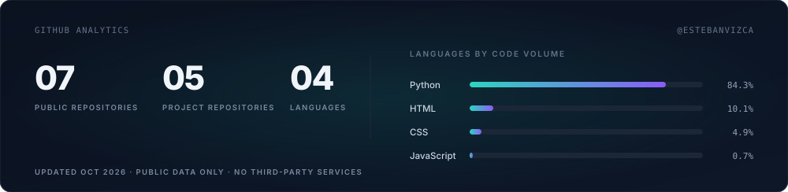

  

### Hi, I'm Esteban — I build small, measured systems.

I'm a telecommunications engineer based in Ibarra, Ecuador, working where **networks, data and machine learning** meet. I build things end to end — data, model, API, evaluation — and I document their limits as carefully as their results.

**Currently** Warehouse Lead at MANSUERA, where I built the inventory system I use every day. **Open to remote ML, data and Python roles**, and available as an independent contractor.

| Focus | Based in | Languages |
|:--|:--|:--|
| Applied ML · data pipelines · network automation | Ibarra, Ecuador (UTC−5) · remote worldwide | Spanish (native) · English (B1–B2) |

### Selected work

| Project | What it does | Result |
|:--|:--|:--|
| **[Local Docs RAG Assistant](https://github.com/estebanvizca/local-docs-rag-assistant)** `Python` `Ollama` `SQLite` | Answers questions about your own PDFs and manuals with page-level citations — or an explicit "not enough information". Fully local, no cloud API. | 24-question held-out eval · **0** external API calls |
| **[I/Q Modulation Classifier](https://github.com/estebanvizca/synthetic-iq-modulation-classifier)** `DSP` `scikit-learn` | Classifies BPSK, QPSK and 8-PSK signals from raw I/Q samples across SNR levels. | **0.959** macro-F1 · **1.00** from +5 dB |
| **[Network QoS Classifier](https://github.com/estebanvizca/network-qos-classifier)** `FastAPI` `scikit-learn` | Diagnoses a degraded link as latency, packet loss or jitter, and shows the measurements behind each call. | **1.00** macro-F1 on unseen scenarios |
| **[Technical Ticket Triage](https://github.com/estebanvizca/technical-ticket-triage)** `NLP` `TF-IDF` | Routes support tickets by category and priority, with a confidence gate that sends uncertain cases to a human. | **0.99** macro-F1 · **1.00** urgent recall |
| **[Hand-Gesture Gallery](https://github.com/estebanvizca/hand-gesture-gallery-controller)** `MediaPipe` `Pygame` | Controls an image gallery with three webcam gestures, plus a keyboard fallback. | 21 landmarks/frame · **600 ms** cooldown |

Projects 2–5 use synthetic or templated data. Each README says so, and their numbers describe a simulator — not a production network.

### Toolbox

**Languages & data** · `Python` `C++17` `SQL` `Bash` `pandas` `NumPy`
**Machine learning** · `PyTorch` `TensorFlow/Keras` `scikit-learn` `XGBoost` `model evaluation`
**Data & backend** · `PostgreSQL` `SQLite` `Redis` `Airflow` `FastAPI` `Flask` `Docker`
**Networks & systems** · `TCP/IP` `MPLS` `BGP` `OSPF` `MQTT` `Wireshark` `Linux` `ESP-IDF`

### Experience & education

- **Warehouse Lead** · MANSUERA S.A. — 2026–present　　 Built and run a Flask + PostgreSQL inventory system for ~3,000 parts; recurring stock checks went from 4–5 h to 1–2 h.
- **Network & Cybersecurity Lab Support** · Universidad Técnica del Norte — 2021–2026　　 Docker attack/defence scenarios, lab network deployments and routing troubleshooting, often remote over SSH.
- **BSc Telecommunications Engineering** · UTN — 2021–2026　　 Thesis: adaptive IoT cipher selection, **19.41 µs** fuzzy and **54.57 µs** neural inference under 1 KB of RAM.
- **Machine Learning Developer Career** · Anyone AI — 2026　　 450+ hours of applied ML.

### GitHub Analytics

  
  Regenerated monthly from the public GitHub API — no third-party services.

### Let's build something measurable

Tell me what you are trying to solve. I usually reply within one business day.

**[esteban-marc2011@hotmail.com](mailto:esteban-marc2011@hotmail.com)** · [Portfolio](https://estebanvizca.github.io) · [LinkedIn](https://www.linkedin.com/in/esteban-vizca%C3%ADno-33558420b/)

Ibarra, Ecuador · UTC−5
